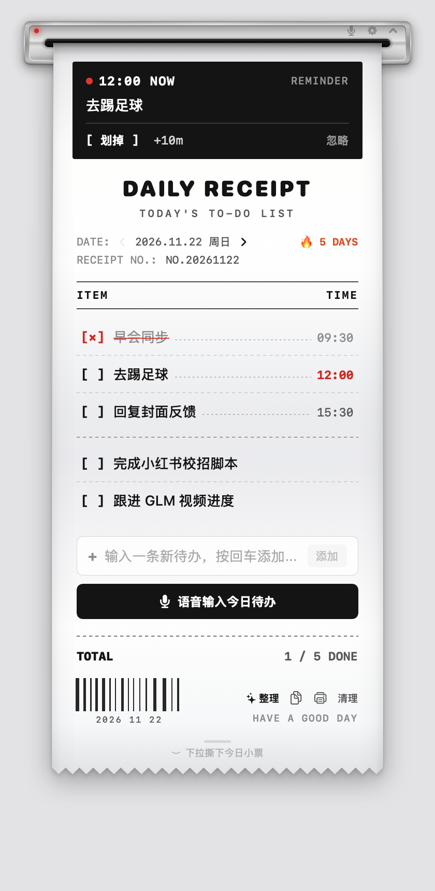
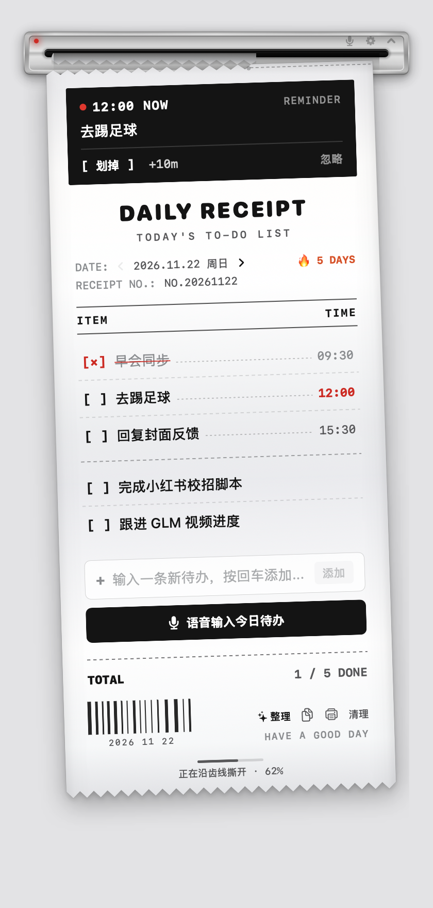
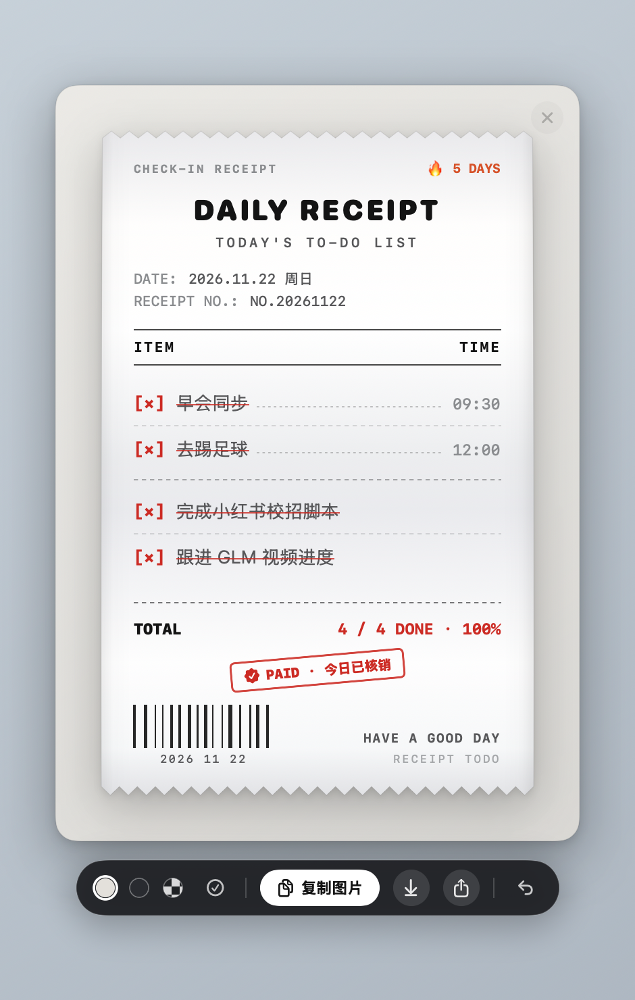
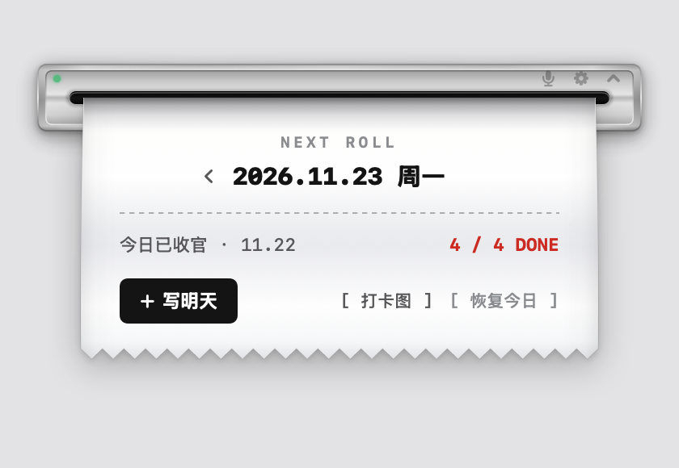
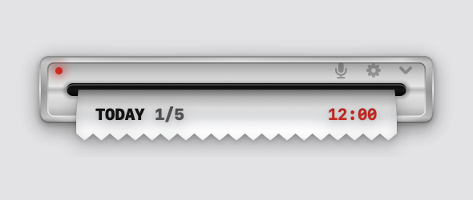

# ReceiptTodo · 小票待办

<p align="center">
  <strong>一款常驻 macOS 桌面角落、像真实热敏纸小票打印机一样的语音打卡 To-Do List</strong>
</p>

<p align="center">
  
  
  
</p>

把每天要做的事像超市小票一样打印并挂在屏幕角落：随手按快捷键说几句话，AI 自动去废话、纠错、拆分成干净条目并提取时间；到点反白黑条醒目提醒；每划掉一项都有真实钢笔划纸声；一天结束时，**沿着锯齿线伴随真实撕纸声把今天撕下来**——直接生成一张可转发朋友圈/微信的高清打卡图，机器则切出清爽的明日新纸头。

---

## 视觉预览

<table>
  <tr>
    <td align="center" width="33%">
      <br/>
      <sub><b>日常待办 & 定时反白提醒条</b></sub>
    </td>
    <td align="center" width="33%">
      <br/>
      <sub><b>边拉边响 · 沿齿线渐进撕下</b></sub>
    </td>
    <td align="center" width="33%">
      <br/>
      <sub><b>撕下直出 · 3x 高清打卡分享图</b></sub>
    </td>
  </tr>
  <tr>
    <td align="center" colspan="2">
      <br/>
      <sub><b>撕完变清爽 · NEXT ROLL 明日新纸头（可一键写明天 / 恢复今日）</b></sub>
    </td>
    <td align="center">
      <br/>
      <sub><b>收起态 · 角落拉丝金属出纸槽</b></sub>
    </td>
  </tr>
</table>

---

## 核心特性

### 1. 拟物拉丝金属出纸槽 & 桌面轻量悬浮
- 原生 `SwiftUI + AppKit NSPanel` 打造，内存极轻、置顶悬浮、跨桌面 Space 跟随，勾选任务不抢占当前工作窗口焦点。
- 支持自由拖拽并记住位置，**自动识别屏幕左/右半区**，收起时向所在一侧收拢成紧凑金属槽，只露出一截锯齿小纸头显示进度与下一条提醒时间。
- 全部采用真实热敏打印机录音、钢笔划纸声与撕纸采样，拒绝廉价电子蜂鸣。

### 2. 每日语音输入 → AI 智能整理 & 语音指令
- **双语音识别引擎**：支持 **macOS 原生中文语音识别** 与 **火山引擎豆包流式语音识别 2.0（SAUC v3）**，支持配置**自定义热词**（专有名词、产品名、人名不再听错）。
- **多模型 AI 整理**：内置 **火山方舟 / DeepSeek / 通义千问 / Gemini / OpenAI / 自定义 OpenAI 兼容接口** 预设，自动去掉口语废话、纠正同音字、拆分复合事项、精准绑定时间（不串项）。
- **自然语音操作**：除了新增待办，还可以直接说 *「把踢足球划掉」*、*「把封面反馈改到下午 4 点」*，或用 **`Option + Space`** 全局快捷键随时开口记录。

### 3. 瑞士小票风定时提醒（Design A）
- 有明确时间的事项按时间顺序排在上方，通过复古虚线引导线 `………… 12:00` 右对齐显示；无时间事项自然排在下方。
- 到达约定时间后，小票顶部弹出高对比度**热敏反白黑条**提醒，支持一键 **`[ 划掉 ]`**、**`+10m` 推迟** 或忽略。

### 4. 一天结束：渐进式撕票 → 无边框高清打卡图 → 明日新纸头
- **真实手感的底部下拉撕纸**：按住小票底部锯齿边缘轻轻下拉，纸张从左向右沿齿线逐齿拉开，**撕纸声随手速实时同步响起**（配合 MacBook 触控板微震动反馈）；拉过阈值松手即清脆断开。
- **撕完直出可传播的打卡图**：不弹繁琐设置对话框，直接浮现一张**无边框 3x 高清双锯齿打卡小票图**；底部悬浮胶囊栏支持切换 **浅灰桌面 / 深色桌面 / 透明纯纸条**、一键 **「仅展示已完成」** 隐藏未完成项，一键 **复制图片**（直贴微信）、**保存 PNG** 或 **隔空投送（AirDrop）** 到手机发朋友圈。
- **翻篇感与反悔权兼得**：撕下后机器自动收净为短小的 **`NEXT ROLL` 明日新纸头**，点 `+ 写明天` 随时提前规划明天（未完成事项自动进入结余），点 `[ 恢复今日 ]` 或在 `<` 历史翻页中随时无损复原。

### 5. 跨周末结余 & 历史翻页 & 日报导出
- **跨周末结余顺延**：自动向前扫描最近 14 天未完成的待办（周末回来也不丢任务），支持 `[全部顺延]`、`挑选` 或 `放下`，顺延项自动带上 `+1D` 标记。
- **历史小票翻页**：点击日期旁的 `<` `>` 随时回看往日小票、重新生成任意一天的打卡图，或一键复制已完成事项粘贴进日报/周报。

---

## 下载与安装（推荐）

前往本仓库右侧的 **[Releases](../../releases)** 页面，下载最新的 `ReceiptTodo-v1.0.0-macOS-arm64.zip`（适用于 Apple Silicon M 系列芯片，macOS 14.0+）：

1. 解压后将 `ReceiptTodo.app` 拖入 **`应用程序（Applications）`** 文件夹。
2. 由于应用采用本地 Ad-hoc 签名（未经 Apple 付费公证），首次打开若遇到 macOS 提示“无法验证开发者”或“已损坏”，在终端执行一行命令解除下载隔离属性即可正常打开：

```bash
xattr -cr /Applications/ReceiptTodo.app
open /Applications/ReceiptTodo.app
```

---

## 从源码构建

仅需安装 macOS Command Line Tools（Swift 5.10+），无需完整 Xcode：

```bash
git clone https://github.com/mesue0820/ReceiptTodo.git
cd ReceiptTodo
chmod +x Scripts/build_app.sh Scripts/package_release.sh
./Scripts/build_app.sh
open build/ReceiptTodo.app
```

如需打包用于分发的 Release `.zip`：

```bash
./Scripts/package_release.sh v1.0.0
```

---

## 配置语音与 AI 引擎

点击小票顶部金属槽右侧的齿轮图标 `⚙`（或顶部菜单栏小票图标 → `设置 API Key 与偏好...`）：
1. **语音识别引擎**：默认开箱即用 macOS 原生中文识别；如需更高准确率与热词纠错，可切换为 **豆包流式语音识别 2.0** 并填入 API Key 及自定义热词。
2. **AI 待办整理引擎**：选择你常用的大模型服务商（火山方舟 / DeepSeek / 通义千问 / Gemini / OpenAI 或自定义），粘贴 API Key 并点击「测试连接」。

---

## 数据与隐私

- **纯本地存储**：所有每日小票记录与个人 API Key 配置均只保存在本机 `~/Library/Application Support/ReceiptTodo/`（配置文件权限 `0600`），应用本身无任何后端服务器或统计上报。
- 只有当你主动触发语音识别或 AI 整理时，才会直接向你在设置中配置的接口发送请求。

---

## 致谢与许可

- 打印机出纸与撕纸音效裁剪自 Freesound CC0 Public Domain 真实热敏打印机录音，叠加 macOS 原生系统音效。
- 本项目基于 [MIT License](LICENSE) 开源。
