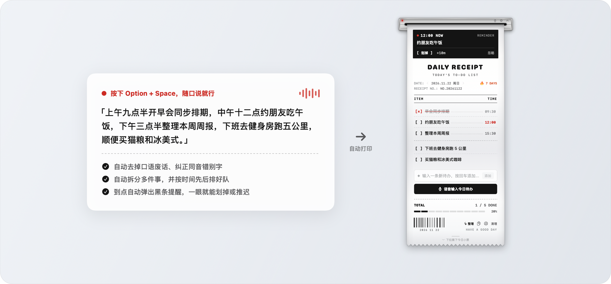
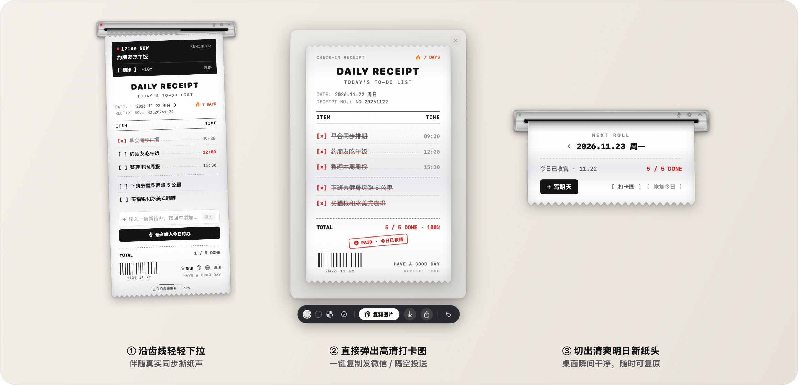
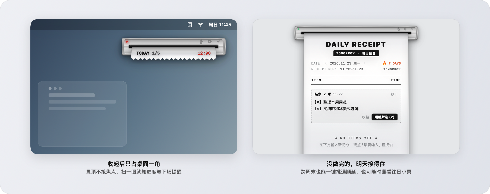

<p align="center">
  
</p>

<p align="center">
  一款常驻 Mac 桌面角落的热敏小票待办工具 —— 随口说、自动排、到点提醒，晚上亲手撕下来变成打卡图。
</p>

<p align="center">
  
  
  
  
</p>

<br>

<a id="download"></a>
<h3 align="center">下载 ReceiptTodo</h3>

<p align="center">
  免费开源 · 仅 853 KB · 无需注册账号，解压即用
</p>

<p align="center">
  <a href="https://github.com/mesue0820/ReceiptTodo/releases/latest">
    
  </a>
</p>

<p align="center">
  <sub>适用于 M 系列芯片（Apple Silicon）macOS 14.0 及以上 · 首次打开若被系统提示“无法验证开发者”，看下方 <a href="#三步上手">三步上手</a> 一行解锁</sub>
</p>

<br>

<h3 align="center">说句话，把今天打印出来</h3>

<p align="center">
  按一下快捷键随口说出今天要做的事，自动去掉口语废话、拆成干净条目并按时间排好队；到点自动弹出黑条提醒。
</p>

<p align="center">
  
</p>

<br>

<h3 align="center">一天结束，亲手把今天撕下来</h3>

<p align="center">
  拉住小票底部的锯齿边缘轻轻下拉，伴随真实撕纸声沿齿线撕开——直接弹出高清打卡图发微信/朋友圈，桌角收净成明日新纸头。
</p>

<p align="center">
  
</p>

<br>

<h3 align="center">藏在角落不挡视线，没做完的明天接得住</h3>

<p align="center">
  平时收起成一条拉丝金属出纸槽，扫一眼就知进度与下一场提醒；没做完的事跨周末也不会丢，第二天一键挑选顺延。
</p>

<p align="center">
  
</p>

<br>

---

## 你能用它做什么

- **随时开口记待办**：按下全局快捷键（默认 `Option + Space`，可在设置里自由录制或切换其他组合键）随口说几句，自动整理成清爽待办；也可以直接说「把吃午饭划掉」「把周报改到下午 4 点」。
- **像真纸一样的打卡手感**：打勾伴随真实钢笔划纸声与红线核销；全部完成后盖上红色 `PAID · 今日已核销` 印章，自动记录连续打卡天数。
- **到点醒目提醒**：有时间的事项按先后排在上方，到点顶部浮现高对比黑条，一键划掉或顺延 10 分钟。
- **撕票出图发朋友圈**：晚上亲手把今日小票撕下，直接呈现无边框 3x 高清打卡图，支持切换背景色、隐藏未完成项、一键复制发微信或隔空投送到手机。
- **贴心收尾与复原**：撕完后小票收短成清爽的 `NEXT ROLL` 明日新纸头；手滑撕早了随时一键恢复，也能翻看任意一天的历史小票或一键复制已完成事项写日报。

---

## 三步上手

1. **下载安装**：点击上方 **[下载 macOS 版本](https://github.com/mesue0820/ReceiptTodo/releases/latest)**，解压后把 `ReceiptTodo.app` 拖进「应用程序」文件夹。
2. **首次打开**：由于是个人开源软件未购买苹果开发者年费签名，首次打开如果遇到系统提示“无法验证开发者”，打开 Mac 自带的「终端」粘贴运行下面一行即可正常打开：
   ```bash
   xattr -cr /Applications/ReceiptTodo.app && open /Applications/ReceiptTodo.app
   ```
3. **开始使用**：直接打字或点击语音按钮记录今天的安排；点右上角齿轮 `⚙` 可按需接入你自己的语音或 AI 整理服务（支持 DeepSeek、火山方舟、通义千问、Gemini、OpenAI 等）。

---

## 常见问题

<details>
<summary><b>不填 API Key 能直接用吗？</b></summary>
<br>

完全可以。不填任何 Key 也能直接打字记待办、使用 Mac 自带的中文语音识别、定时提醒、下拉撕票、生成高清打卡图和历史回看。填入 AI 大模型 Key 后，可以获得更聪明的口语去废话、热词纠错和语音指令改时间体验。

</details>

<details>
<summary><b>我的待办记录和 API Key 会上传到云端吗？</b></summary>
<br>

不会。所有待办记录与设置均仅保存在你自己的电脑本地目录（`~/Library/Application Support/ReceiptTodo/`），软件本身没有任何后端服务器或数据收集行为。只有当你主动触发语音或 AI 整理时，才会直接请求你在设置里填写的接口。

</details>

<details>
<summary><b>不小心把今天的小票撕早了怎么办？</b></summary>
<br>

完全不用担心，数据不会丢失。刚弹出的打卡图下方有 `↩` 一键撤销按钮，撕完后的明日新纸头上也有 `[ 恢复今日 ]`，点一下就会把今天的小票原封不动吐回来；随时也可以点日期旁的 `<` 翻回历史记录重新生成打卡图。

</details>

<details>
<summary><b>支持 Intel 芯片的旧款 Mac 吗？</b></summary>
<br>

目前预编译好的 `.zip` 安装包面向 Apple Silicon（M1/M2/M3/M4）芯片、macOS 14.0 及以上系统。如果你是 Intel Mac，展开下方「开发者从源码运行」即可在本机直接编译使用。

</details>

---

## 开发者从源码运行

<details>
<summary><b>点击展开：本地编译与打包命令（无需 Xcode，仅需 Swift 5.10+）</b></summary>
<br>

```bash
git clone https://github.com/mesue0820/ReceiptTodo.git
cd ReceiptTodo
chmod +x Scripts/build_app.sh Scripts/package_release.sh
./Scripts/build_app.sh
open build/ReceiptTodo.app
```

如需打包用于分发的 Release `.zip`：

```bash
./Scripts/package_release.sh v1.0.0
```

</details>

---

<p align="center">
  <sub>基于 <a href="LICENSE">MIT License</a> 开源 · 打印机与撕纸音效裁剪自 Freesound CC0 公共领域真实录音</sub>
</p>
